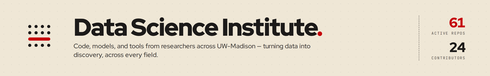

  

  <a href="https://dsi.wisc.edu/">Website</a> &bull;
  <a href="https://dsi.wisc.edu/services/data-science-services/">Services</a> &bull;
  <a href="https://dsi.wisc.edu/services/gpu/">Computing Resources</a> &bull;
  <a href="mailto:research@datascience.wisc.edu">Contact Us</a>

The **Data Science Institute (DSI)**, powered by American Family Insurance, is central to UW-Madison's strategic priority to grow its research enterprise and expand its global impact. We pair campus researchers with data scientists and research software engineers to develop customized solutions that extract value from data and open new research directions. Find out more at [dsi.wisc.edu](https://dsi.wisc.edu/).

**To get started**, reach out to us either by [scheduling a consultation](https://dsi.wisc.edu/services/data-science-services/) or by emailing us at [research@datascience.wisc.edu](mailto:research@datascience.wisc.edu). More information on our computing resources can be found [here](https://dsi.wisc.edu/services/gpu/).

<!-- ACTIVE_REPOS:START -->
### 🔥 Most active repos (last 30 days)

| Repo | Commits | Description |
| --- | ---: | --- |
| [pixi-docker-chtc](https://github.com/UW-Madison-DSI/pixi-docker-chtc) | 4 | Example configurations for using containerized pixi environments with HTCondor and GPUs |
| [.github](https://github.com/UW-Madison-DSI/.github) | 3 | Landing page of GitHub organization |
| [hela_hpv18](https://github.com/UW-Madison-DSI/hela_hpv18) | 1 |  |
| [agentic-web-extraction](https://github.com/UW-Madison-DSI/agentic-web-extraction) | 1 | Web crawling agent + Structural extraction |
| [llm-ag-forecasting-app](https://github.com/UW-Madison-DSI/llm-ag-forecasting-app) | 1 | Open Source LLM powered Ag forecasting app for crop management decision making (v3) |

_Updated 2026-11-09_
<!-- ACTIVE_REPOS:END -->
