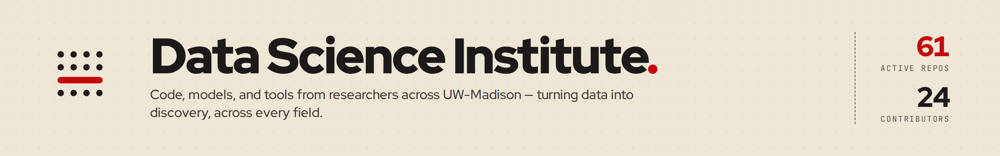

  

  <a href="https://dsi.wisc.edu/">Website</a> &bull;
  <a href="https://dsi.wisc.edu/services/data-science-services/">Services</a> &bull;
  <a href="https://dsi.wisc.edu/services/gpu/">Computing Resources</a> &bull;
  <a href="mailto:research@datascience.wisc.edu">Contact Us</a>

The **Data Science Institute (DSI)**, powered by American Family Insurance, is central to UW-Madison's strategic priority to grow its research enterprise and expand its global impact. We pair campus researchers with data scientists and research software engineers to develop customized solutions that extract value from data and open new research directions. Find out more at [dsi.wisc.edu](https://dsi.wisc.edu/).

<!-- ACTIVE_REPOS:START -->
### 🔥 Most active repos (last 30 days)

| Repo | Commits | Description |
| --- | ---: | --- |
| [.github](https://github.com/UW-Madison-DSI/.github) | 14 | Landing page of GitHub organization |
| [pixi-docker-chtc](https://github.com/UW-Madison-DSI/pixi-docker-chtc) | 4 | Example configurations for using containerized pixi environments with HTCondor and GPUs |
| [hela_hpv18](https://github.com/UW-Madison-DSI/hela_hpv18) | 1 |  |

_Updated 2026-11-16_
<!-- ACTIVE_REPOS:END -->
